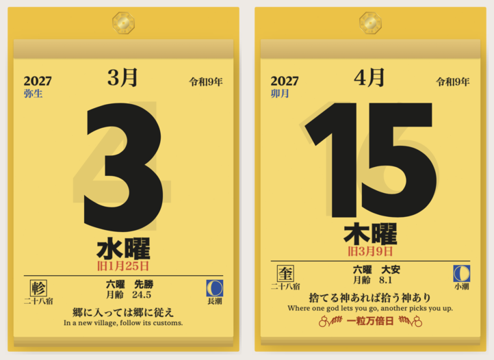
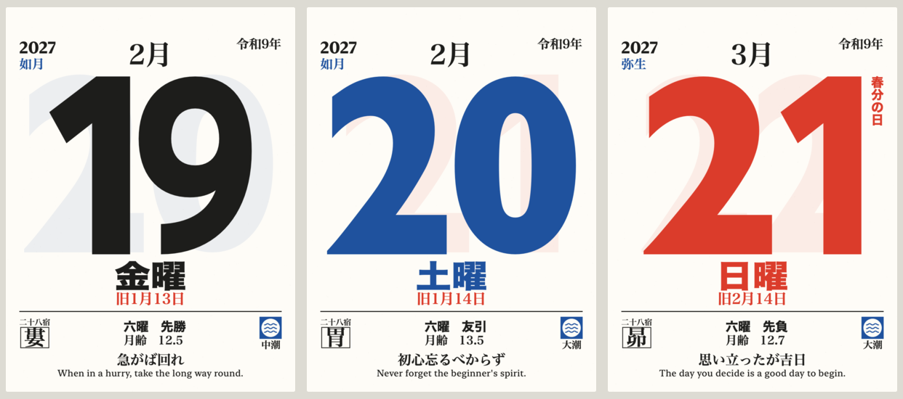
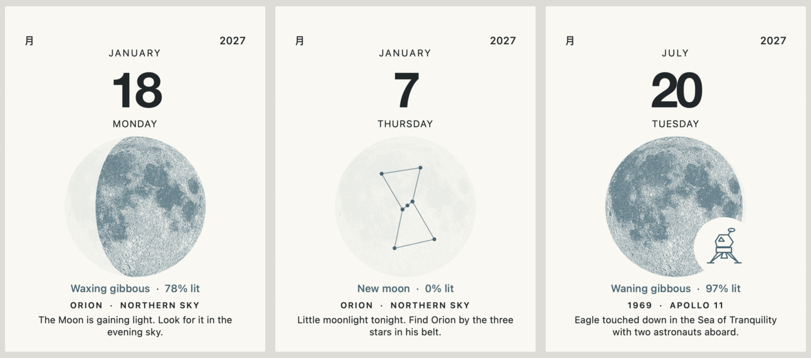
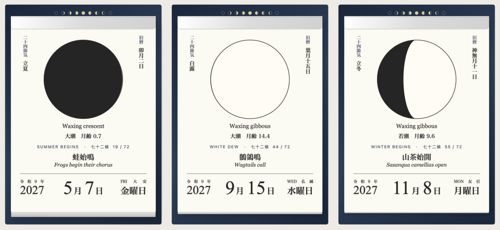

# Paper Almanac

*A daily East Asian–inspired paper almanac*

Paper Almanac is based on **Himekuri 日めくり**, Pluk’s original macOS tear-off calendar. It adapts Himekuri’s desktop pad and four of its print styles, Shōwa Print, Koyomi, Huangli, and Tong Sheng. Paper Almanac uses its own Metal paper physics engine to simulate how sheets lift, tear, and fall. [Original Himekuri source](https://github.com/pluk-inc/himekuri) · [Himekuri website](https://himekuri.app/)

Paper Almanac works offline on Mac, iPhone, and iPad and opens to the local date. The default Yut Lik theme shows the lunar date, solar term, a weekly proverb, and the day's Do and Avoid activities. Tap or click an activity list to read it in full. Pick from fifteen themes, including Twin Pillars, Celestial Almanac, Fuji, Tsukikage, Tsukigoyomi, Rekichū, Kin’un, Illyeok, and Lịch Việt. Widgets follow your selected theme.


Drag the sheet to lift it, or pull a bottom corner diagonally to tear it. Release an attached sheet to let it settle back. A completed tear advances one day. On iPhone and iPad, tap the date number to return to today, or choose **Today** in the **Go to Date…** calendar. On Mac, drag the binding strip to move the calendar, including up to the menu bar and screen edges. Switching themes keeps the visible top-left corner in place. With Kin’un or Tsukigoyomi, you can also grab the exposed backing board above, beside, or below the paper. Clicking the menu-bar calendar brings the pad forward. Use that menu to jump to a date, change themes, or resize the pad.

Turn off **Auto Change Date** in the menu-bar calendar on Mac or the palette menu on iPhone and iPad to keep the pad on its current page. It stays there across midnight and app relaunches. A tear advances the held page by one day. Choose **Today** to hold the current date, or turn automatic updates back on to resume daily rollover.

The **Extra Large Portrait** widget displays one complete, borderless page in your selected theme. On iPhone, open the widget picker from the Home Screen. On iPad, swipe right from the first Home Screen page to open Today View, then open the picker there. Choose **Paper Almanac** and swipe to the tall preview.

## Twin Pillars

Twin Pillars prints the traditional Chinese year and day names in two vertical columns. Between them sit the large date numeral, the English weekday in vermilion, and the lunar date. A fine horizontal line introduces the activity lists, where 宜 (Do) and 忌 (Avoid) pick up the weekday’s red ink.

If you previously selected Desk Ledger or Almanac Columns, the app and its widgets automatically use Twin Pillars.

## Illyeok · 일력

Illyeok draws on a Korean wall calendar with a mint-green binding, a miniature month grid, and patterned date numerals. The page gives the lunar date using the Korean Dangi calendar in Seoul time and the day’s sexagenary name. Saturdays print in blue, and Sundays and January 1 print in red. A striped taegeuk sits behind the New Year’s Day numeral.

In the space the original pad set aside for handwritten notes, Illyeok prints a Korean proverb and an English reading. The 31 sayings rotate by civil date, including across New Year. The apps and widgets share the same offline collection. [Proverb credits](THIRD_PARTY_NOTICES.md)

## Lịch Việt

Lịch Việt pairs a red-and-gold blossom binding with green ruled daily pages inspired by Vietnamese tear-off calendars. The large Gregorian date sits above the Vietnamese lunar date, Can Chi day and year, and six traditional auspicious hours. A one-ink portrait beside the lunar day shows the animal of the day’s earthly branch. Sundays and lunar festivals print in red. On February 17, 2026, the page marks Tết Nguyên Đán and the start of Bính Ngọ, the Year of the Horse.

Lunar dates are calculated offline for 1901–2100 using the modern Vietnamese UTC+7 convention throughout. The calendar marks leap months and uses the Vietnamese zodiac, including the cat and water buffalo. [Vietnamese calendar rules](https://www.xemamlich.uhm.vn/calrules_en.html)

## Kin’un

Kin’un (金運) pairs butter-yellow sheets with a saffron backing board. A single gilt octagonal mirror sits above the binding. The colors draw on the custom of hanging yellow on a west wall as a wish for prosperity. Choose **Kin’un** from the Mac menu bar or the palette menu on iPhone and iPad. [Print reference](https://www.nkcalendar.co.jp/products/calendar-naire/daily-calendar-naire/nk-553.html)

The full page shows the Japanese weekday, old-calendar date, Rokuyō, daily mansion, lunar age, tide name, and a Japanese saying with its English reading. The blue square shows the Moon’s phase at noon in Japan. On 一粒万倍日 (“one grain, ten thousandfold”) days, vermilion gourds and rice sprigs flank the inscription. The app calculates these days offline from the Japanese solar month and the day’s zodiac branch. To see the ornaments, open **Go to Date…** and choose April 15, 2027. [Calendar rule](https://www.ndl.go.jp/koyomi/chapter3/s6.html)



## Rekichū

Rekichū (暦注) takes its name from the traditional annotations printed beside a date. The design draws on Shin Nippon Calendar’s small daily tear-off pad. Ordinary weekdays print in black, Saturdays in blue, and Sundays and Japanese public holidays in vermilion. The faint numeral beneath the date belongs to the next sheet.



Choose **Rekichū** in the Mac menu bar or the palette menu on iPhone and iPad. The full page pairs a Japanese saying and its English reading with the Japanese old-calendar date, Rokuyō (六曜), the day’s mansion in the 28-day cycle (二十八宿), and lunar age at noon in Japan. Small widgets and CarPlay show a shorter reading with the date, Rokuyō, tide name, and Japanese saying.

The 140 sayings rotate once per day, continuing across New Year. The collection includes the 16 original Himekuri sayings and 124 additional selections. [Sources and credits](THIRD_PARTY_NOTICES.md)

The tide name follows the traditional old-calendar day classification. Actual coastal tide heights and times depend on the location. [Japanese calendar mansions](https://eco.mtk.nao.ac.jp/koyomi/wiki/C6F3BDBDC8ACBDC9.html) · [Japan Coast Guard tide guide](https://www.kaiho.mlit.go.jp/07kanku/senzaki/03_oyakudachi/pdf/guidebook2026.pdf)

## Tsukikage

Tsukikage (月影) means “moonlight.” Choose **Tsukikage** from the Mac menu-bar calendar or the palette menu on iPhone and iPad. The blue-gray lunar print shows the phase and illuminated fraction for the displayed date, calculated at noon UTC. Near new moon, a constellation chart appears on the dim disk. On selected spaceflight anniversaries, a spacecraft drawing and a historical note mark the event.



The default sky notes use a northern mid-latitude viewpoint and require no location permission. To see where to look from your area, select **Use Current Location** in the same menu. Local notes give a guide star’s direction and approximate height above the horizon at 9 PM in your device’s time zone. The app rounds your coordinates to the nearest degree and shares them with its widgets on that device. Turning the option off clears the saved coordinates and restores the northern sky notes.

## Tsukigoyomi

Tsukigoyomi (月暦) places an ivory tear-off sheet on an indigo board with a silver clip and a row of gold moon phases. The large ink disk follows the Moon at noon in Japan. Its flanking columns carry the current solar term and old-calendar date. Beneath it, the page gives the lunar age, traditional tide name, and the current microseason in Japanese and English. The footer pairs the English weekday with the day’s Rokuyō (六曜).



Choose **Tsukigoyomi** in the Mac menu bar or the palette menu on iPhone and iPad. For the November page shown above, open **Go to Date…** and select November 8, 2027. The page marks the start of winter (立冬) with “Sasanqua camellias open” (山茶始開).

Each of the 24 solar terms contains three microseasons. A new microseason begins on the Japanese civil date when the apparent Sun crosses the next five-degree division. The readings work offline from 1901 through 2100. Full-page widgets carry the printed footer, while smaller widgets and CarPlay show the date, moon phase, and seasonal reading. [Print reference](https://www.543life.com/i/1000000021001) · [Japanese calendar data](https://eco.mtk.nao.ac.jp/koyomi/yoko/)

[Release notes](CHANGELOG.md)

## Build from a clone

Use Xcode 27.2 with Swift 6.4. The targets run on macOS 27.0 and iOS or iPadOS 27.1 or later. The repository includes the daily engine and its offline data, so package resolution requires only the files in this checkout.

Open `TungShingDaily.xcodeproj`. Choose **TungShingDaily** for Mac or **TungShingMobile** for an iPhone or iPad simulator. The Xcode project is checked in. If you change target membership or project settings, regenerate it with `xcodegen generate`.

For command-line builds with no Apple developer team configured:

```sh
xcodebuild -project TungShingDaily.xcodeproj -scheme TungShingDaily \
  -destination 'platform=macOS' CODE_SIGN_ENTITLEMENTS= build

xcodebuild -project TungShingDaily.xcodeproj -scheme TungShingMobile \
  -destination 'generic/platform=iOS Simulator' CODE_SIGNING_ALLOWED=NO build
```

For device installation and shared app/widget preferences, configure your Apple development team and signing in Xcode. Set `PAPER_ALMANAC_BUNDLE_ID` to your registered app identifier and `PAPER_ALMANAC_APP_GROUP` to the group shared by the app and widget. Use the group registered for the target platform. The widget appends `.widget` to the app identifier. The app uses its local preferences when a shared App Group is unavailable.

For a signed Mac archive from the command line, pass `DEVELOPMENT_TEAM=<team-id>`, `CODE_SIGN_STYLE=Automatic`, and `PAPER_ALMANAC_MAC_SIGNING_IDENTITY="Apple Development"` along with your app identifier and group overrides. The Mac identity setting applies to the app and widget, so Swift Package Manager's data bundles remain unsigned and are sealed as resources by the enclosing targets. For a rebuilt release, pass a new `CURRENT_PROJECT_VERSION` when archiving.

Run `swift run DailyProof --export /path/to/output` to render the three reference dates without launching the app.

## License and attribution

Paper Almanac and the included daily engine are MIT-licensed. See the separate notices for the fonts, proverbs, engine data, and artwork. [MIT License](LICENSE) · [Third-party notices](THIRD_PARTY_NOTICES.md) · [Daily engine](Engine/README.md) · [Pluk’s MIT notice](Shared/Himekuri-LICENSE.txt)
