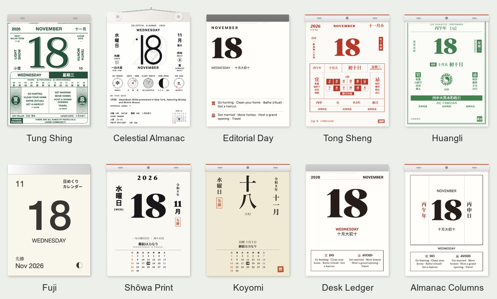

# Paper Almanac

*A daily East Asian–inspired paper almanac*

Paper Almanac is based on **Himekuri 日めくり**, Pluk’s original macOS tear-off calendar. It adapts Himekuri’s desktop pad and four of its print styles, Shōwa Print, Koyomi, Huangli, and Tong Sheng. Paper Almanac uses its own Metal paper physics engine to simulate how sheets lift, tear, and fall. [Original Himekuri source](https://github.com/pluk-inc/himekuri) · [Himekuri website](https://himekuri.app/)

Paper Almanac works offline on Mac, iPhone, and iPad and opens to the local date. The default Yut Lik theme shows the lunar date, solar term, a weekly proverb, and the day's Do and Avoid activities. Tap or click an activity list to read it in full. Pick from ten themes, including Celestial Almanac and the Japanese Fuji calendar. Widgets follow your selected theme.



Drag the sheet to lift it, or pull a bottom corner diagonally to tear it. Release an attached sheet to let it settle back. A completed tear advances one day. On iPhone and iPad, tap the date number to return to today, or choose **Today** in the **Go to Date…** calendar. On Mac, clicking the menu-bar calendar brings the pad forward. Use that menu to jump to a date, change themes, or resize the pad.

Turn off **Auto Change Date** in the menu-bar calendar on Mac or the palette menu on iPhone and iPad to keep the pad on its current page. It stays there across midnight and app relaunches. A tear advances the held page by one day. Choose **Today** to hold the current date, or turn automatic updates back on to resume daily rollover.

[Release notes](CHANGELOG.md)

## Build from a clone

Use Xcode 27.2 with Swift 6.4. The targets run on macOS 27.0 and iOS or iPadOS 27.1 or later. The repository includes the daily engine and its offline data, so package resolution requires only the files in this checkout.

Open `TungShingDaily.xcodeproj`. Choose **TungShingDaily** for Mac or **TungShingMobile** for an iPhone or iPad simulator. The Xcode project is checked in. If you change target membership or project settings, regenerate it with `xcodegen generate`.

For command-line builds with no Apple developer team configured:

```sh
xcodebuild -project TungShingDaily.xcodeproj -scheme TungShingDaily \
  -destination 'platform=macOS' CODE_SIGN_ENTITLEMENTS= build

xcodebuild -project TungShingDaily.xcodeproj -scheme TungShingMobile \
  -destination 'generic/platform=iOS Simulator' CODE_SIGNING_ALLOWED=NO build
```

For device installation and shared app/widget preferences, configure your Apple development team and signing in Xcode. Set `PAPER_ALMANAC_BUNDLE_ID` to your registered app identifier and `PAPER_ALMANAC_APP_GROUP` to the group shared by the app and widget. Use the group registered for the target platform. The widget appends `.widget` to the app identifier. The app uses its local preferences when a shared App Group is unavailable.

For a signed Mac archive from the command line, pass `DEVELOPMENT_TEAM=<team-id>`, `CODE_SIGN_STYLE=Automatic`, and `PAPER_ALMANAC_MAC_SIGNING_IDENTITY="Apple Development"` along with your app identifier and group overrides. The Mac identity setting applies to the app and widget, so Swift Package Manager's data bundles remain unsigned and are sealed as resources by the enclosing targets. For a rebuilt release, pass a new `CURRENT_PROJECT_VERSION` when archiving.

Run `swift run DailyProof --export /path/to/output` to render the three reference dates without launching the app.

## License and attribution

Paper Almanac and the included daily engine are MIT-licensed. See the separate notices for the fonts, proverbs, engine data, and artwork. [MIT License](LICENSE) · [Third-party notices](THIRD_PARTY_NOTICES.md) · [Daily engine](Engine/README.md) · [Pluk’s MIT notice](Shared/Himekuri-LICENSE.txt)
